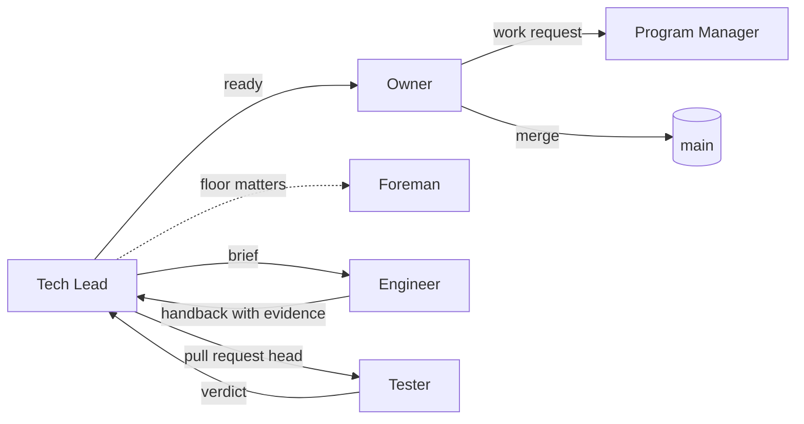

# The factory in one picture

This page draws the roles and the way work moves, as the [roles](roles.md), [glossary](glossary.md) and [lifecycle](lifecycle.md) pages of this repository describe them, and from [ADR 0001](adr/0001-the-factorys-objects-and-roles.md). Admitting a request through the Program Manager and the work order are design and not yet built.

## The cast

Six roles do the work. One of them is the Owner.

| Role | In one line |
| --- | --- |
| Owner | decides what only the Owner can: what to work on and every merge |
| Program Manager | translates a request into the factory's terms and drafts the wording of what leaves, for the Owner's approval |
| Foreman | looks after the floor across lanes: capacity, stalls, who holds what |
| Tech Lead | takes one work order at a time and drives it to a pull request that is ready for the Owner |
| Engineer | builds one slice from a brief and hands back evidence |
| Tester | checks a round's candidate or a pull request head against its criteria (an adversarial review is given none), read-only, and writes one verdict per head |

[Roles in practice](roles.md) says how the Tech Lead, Engineer, Tester and Owner work day to day, and an occasional judge. The [glossary](glossary.md) defines the words, including the Program Manager and the Foreman.

## The things that move

- A **work request** is what the Owner asks for, in public words.
- A **work order** is the request restated in the factory's terms. It has one state machine, from raw to done, with failed and abandoned as final states. The work order itself is design and not yet built.
- A **round** is one operation on a work order: design, build, verify or fix.

## The picture

The Program Manager translates a request into factory terms; for technical meaning it works with the Tech Lead, which the picture does not draw. The Foreman assigns holders and sequences work across lanes.

The rule that runs through all of it: a step is crossed only when the file behind it exists. [How a piece of work moves](lifecycle.md) follows one piece of work through the steps.

## What an agent may not do

An Engineer never merges, pushes to main, changes credentials or settings, or posts publicly. A Tester is read-only: it never changes the subject, pushes, merges or comments publicly. The Owner merges.

## What this page does not say

It does not say how any one factory is set up, which tools it uses, or how much it runs. [How the private factory uses Middle Path](private-factory.md) says how the private factory relates to this repository.
